# Panduan Demonstrasi MVP KlasiFas

Dokumen ini menjadi panduan validasi TSK-F8-04 untuk memperagakan alur KlasiFas dari pelaporan publik sampai dashboard manajerial. Seluruh route, role, dan perilaku di bawah mengacu pada implementasi aktual di workspace, bukan rancangan baru.

## 1. Prasyarat

1. Gunakan Python 3.11 dan virtual environment proyek. Jalankan semua perintah berikut dari PowerShell pada direktori project:

   ```powershell
   Set-Location "D:\Project Capstone\Klasifas"
   ```

2. Siapkan PostgreSQL development yang terpisah dari database pengujian.
3. Salin `.env.example` menjadi `.env`, lalu isi `FLASK_CONFIG=development`, `SECRET_KEY`, dan `DEV_DATABASE_URL` sesuai README. Jangan menampilkan atau membagikan isi `.env`.
4. Pasang dependensi:

   ```powershell
   Set-Location "D:\Project Capstone\Klasifas"
   python -m pip install -r requirements.txt
   ```

5. Terapkan migration ke database development:

   ```powershell
   Set-Location "D:\Project Capstone\Klasifas"
   flask --app "app:create_app('development')" db upgrade
   ```

   Migration `0002_seed_categories` menyediakan kategori resmi K1-K7. Jangan mengisi kategori secara manual dengan data karangan.

6. Pastikan direktori `uploads/` dapat ditulis aplikasi. Direktori ini tidak boleh berada di area aset publik.
7. Artefak model ML bersifat opsional. Jika `app/ml/models/model.joblib` dan `vectorizer.joblib` tidak tersedia, aplikasi memakai fallback manual FR-10. Jangan membuat, mengunduh, atau mengarang dataset/model hanya untuk demonstrasi.
8. Jalankan aplikasi:

   ```powershell
   Set-Location "D:\Project Capstone\Klasifas"
   flask --app "app:create_app('development')" run --debug
   ```

9. Buka `http://127.0.0.1:5000`.

## 2. Akun dan Role Demo

Tidak ada akun demo bawaan dan tidak ada kredensial yang disimpan di dokumentasi ini. Buat akun sendiri melalui CLI lokal; password dimasukkan lewat prompt tersembunyi, minimal 12 karakter.

| Role | Kegunaan demonstrasi | Contoh username placeholder |
|---|---|---|
| `admin_sarpras` | Verifikasi kategori, penugasan teknisi, audit log, dashboard | `admin.demo` |
| `teknisi` | Pengerjaan tiket yang ditugaskan, perubahan status | `teknisi.demo` |
| `pimpinan` | Dashboard agregat read-only | `pimpinan.demo` |

Contoh pembuatan akun:

```powershell
Set-Location "D:\Project Capstone\Klasifas"
flask --app "app:create_app('development')" create-staff `
  --username admin.demo `
  --role admin_sarpras `
  --full-name "Admin Demo"
```

Ulangi dengan role `teknisi` dan `pimpinan`. Ganti username placeholder dengan nama yang disepakati. Password tidak boleh dituliskan di guide, terminal history, screenshot, atau log.

Role yang valid hanya `admin_sarpras`, `teknisi`, dan `pimpinan`. Tidak ada registrasi publik.

## 3. Matriks Route dan Akses

| Route | Metode | Akses | Fungsi |
|---|---|---|---|
| `/` | GET | Publik | Redirect ke `/lapor` |
| `/lapor` | GET, POST | Publik | Formulir dan penyimpanan laporan |
| `/lapor/sukses` | GET | Publik | Redirect kembali ke `/lapor`; bukan halaman untuk mengambil token |
| `/lacak` | GET, POST | Publik dengan kode + token valid | Pelacakan status tiket |
| `/auth/login` | GET, POST | Publik | Login staf |
| `/auth/logout` | POST | Staf login | Logout |
| `/admin/tiket` | GET | `admin_sarpras` | Antrean dan filter tiket |
| `/admin/tiket/<id>/verifikasi` | GET, POST | `admin_sarpras` | Detail, verifikasi, koreksi kategori |
| `/admin/tiket/<id>/penugasan` | POST | `admin_sarpras` | Penugasan teknisi |
| `/admin/tiket/<id>/foto` | GET | `admin_sarpras` | Foto bukti terproteksi |
| `/admin/audit-log` | GET | `admin_sarpras` | Riwayat audit operasional |
| `/teknisi/tiket` | GET | `teknisi` | Papan tugas milik teknisi login |
| `/teknisi/tiket/<id>` | GET | `teknisi` | Detail tiket yang ditugaskan |
| `/teknisi/tiket/<id>/foto` | GET | `teknisi` | Foto tiket yang ditugaskan |
| `/teknisi/tiket/<id>/status` | POST | `teknisi` | Perubahan status pengerjaan |
| `/dashboard` | GET | `admin_sarpras`, `pimpinan` | Dashboard manajerial |
| `/dashboard/api/chart-data` | GET | `admin_sarpras`, `pimpinan` | Data agregat grafik |

Perilaku akses: pengguna yang belum login diarahkan ke `/auth/login`; pengguna login dengan role salah mendapat `403`. Pimpinan hanya memiliki dashboard read-only. Teknisi tidak dapat membuka dashboard atau audit log.

Logout wajib melalui tombol UI yang mengirim form POST ke `/auth/logout`. Jangan membuka `/auth/logout` langsung sebagai URL (GET); itu bukan logout yang sah.

## 4. Langkah Demonstrasi

### Langkah 1 - Pelaporan publik

1. Buka `/lapor`.
2. Isi deskripsi keluhan yang nyata dan spesifik, misalnya keluhan fasilitas yang benar-benar akan disimulasikan. Jangan memakai data pribadi nyata.
3. Pilih lantai 1-4 dan isi nama/nomor ruang. Gedung sudah tetap `Gedung FTII`.
4. Nama, kontak, kategori pelapor, dan foto bersifat opsional.
5. Jika memakai foto, gunakan JPG/JPEG/PNG maksimal 3 MB dan dimensi maksimal 6000 x 6000 piksel. Foto tidak dipakai untuk klasifikasi.
   - Area unggah foto mendukung *drag-and-drop* file gambar maupun klik untuk memilih file dari komputer.
   - Setelah berkas dipilih, pratinjau (*thumbnail*) lokal langsung tampil beserta nama berkas, ukuran, dan tombol hapus jika ingin membatalkan/mengganti foto sebelum formulir dikirim.
6. Kirim laporan.

Hasil yang diharapkan:

- Halaman konfirmasi menampilkan kode tiket berformat `KF-XXXXXX` dan token akses rahasia.
- Token hanya ditampilkan sekali pada respons POST `/lapor` dan respons memakai `Cache-Control: no-store`.
- Simpan kode dan token sebelum meninggalkan halaman. Jangan membagikan token.
- Jika model ML tidak tersedia atau inferensi gagal, tiket tetap tersimpan dengan status `Baru` dan penanda verifikasi manual. Pelapor tidak menerima pesan error teknis.
- Jika tidak ada foto, metadata foto tetap kosong dan tiket tetap valid.
- Jangan membuka `/lapor/sukses` untuk mengambil token; route itu hanya redirect ke formulir.

### Langkah 2 - Pelacakan awal

1. Buka `/lacak`.
2. Masukkan kode tiket dan token akses melalui form POST.
3. Kirim pencarian.

Hasil yang diharapkan:

- Tiket baru tampil dengan status `Baru`.
- Data publik yang tampil mencakup kode, status, waktu, lokasi, deskripsi, nama kategori jika tersedia, dan penanda ada/tidaknya foto.
- Nama/kontak pelapor, teknisi, token, hash token, dan nama file internal tidak ditampilkan.
- Token salah atau kode tidak ditemukan menghasilkan pesan generik dan status `404`, tanpa membedakan penyebabnya.
- Form `/lacak` yang dikirim kosong (kode dan/atau token tidak diisi) ditolak dengan `400`.
- Pencarian dibatasi rate limit; jika batas tercapai, respons `429` dengan `Retry-After`.

### Langkah 3 - Verifikasi Admin Sarpras

1. Login melalui `/auth/login` sebagai `admin_sarpras`.
2. Buka menu `Antrean Sarpras` atau `/admin/tiket`.
3. Cari tiket berdasarkan kode. Antrean awal default menampilkan status `Baru`.
4. Buka detail verifikasi `/admin/tiket/<id>/verifikasi`.
5. Periksa deskripsi, lokasi, foto jika ada, rekomendasi ML dan confidence jika tersedia, serta penanda verifikasi manual.
6. Pilih satu kategori resmi K1-K7 pada form verifikasi. Catatan verifikasi opsional.
7. Simpan verifikasi.

Hasil yang diharapkan:

- Status berubah dari `Baru` menjadi `Terverifikasi`.
- Kategori resmi tersimpan dan penanda verifikasi manual dibersihkan jika sebelumnya aktif.
- Perubahan kategori/status tercatat di riwayat audit dan `/admin/audit-log`.
- Tiket berstatus `Baru` belum dapat ditugaskan. Penugasan baru tersedia setelah verifikasi.

### Langkah 4 - Penugasan teknisi

1. Masih di halaman verifikasi tiket yang sudah `Terverifikasi`.
2. Pilih teknisi aktif pada form `Penugasan Teknisi Lapangan`.
3. Catatan penugasan opsional.
4. Simpan penugasan.

Hasil yang diharapkan:

- Tiket menampilkan teknisi penanggung jawab.
- Penugasan tercatat di audit log.
- Penugasan hanya diterima untuk tiket `Terverifikasi` atau penugasan ulang pada `Diproses`; tiket `Baru` dan `Selesai` ditolak.
- Teknisi yang dipilih harus akun aktif dengan role `teknisi`.

### Langkah 5 - Pengerjaan oleh teknisi

1. Logout lewat tombol UI (bukan URL `/auth/logout`), lalu login sebagai `teknisi`.
2. Buka menu `Tugas Saya` atau `/teknisi/tiket`.
3. Buka detail tiket yang ditugaskan.
4. Pada status `Terverifikasi`, klik `Mulai Pengerjaan (Ubah Status ke Diproses)`. Catatan opsional.
5. Setelah pekerjaan selesai, isi `Catatan Tindakan Perbaikan` yang wajib, lalu klik `Selesaikan Pekerjaan (Ubah Status ke Selesai)`.

Hasil yang diharapkan:

- Teknisi hanya melihat tiket yang ditugaskan kepadanya. Tiket teknisi lain atau tiket yang tidak ditugaskan menghasilkan `404`.
- Status bergerak `Terverifikasi` -> `Diproses` -> `Selesai`.
- Transisi ke `Selesai` tanpa catatan ditolak.
- Pada status `Selesai`, `resolved_at` dan `resolution_note` terisi.
- Setiap perubahan status dan catatan tercatat di audit log.
- Teknisi tidak dapat membuka `/dashboard` atau `/admin/audit-log`.

### Langkah 6 - Pelacakan akhir

1. Logout dari akun staf melalui tombol UI (bukan URL `/auth/logout`).
2. Buka `/lacak` dan masukkan kode serta token yang sama.
3. Periksa hasil pelacakan.

Hasil yang diharapkan:

- Status akhir `Selesai` tampil.
- Catatan tindakan perbaikan hanya tampil setelah tiket `Selesai`.
- Identitas pelapor, teknisi, token, dan data internal tetap tidak tampil.

### Langkah 7 - Audit dan dashboard

1. Login sebagai `admin_sarpras`.
2. Buka `/admin/audit-log`, filter berdasarkan kode tiket.
3. Periksa entri perubahan kategori, status, dan penugasan.
4. Buka `/dashboard`.
5. Ubah filter periode 1-365 hari, kategori K1-K7, atau lantai 1-4.
6. Logout lewat tombol UI (bukan URL `/auth/logout`), lalu login sebagai `pimpinan` dan buka `/dashboard`.

Hasil yang diharapkan:

- Audit log hanya dapat dibaca Admin Sarpras dan memuat aktor, waktu, aksi, nilai lama/baru, serta catatan yang relevan.
- Saat filter dasbor diubah atau tombol perbarui ditekan, efek transisi *skeleton loading shimmer* muncul secara halus pada kartu grafik dan KPI sebelum data baru dirender, mencegah efek kedip (*layout shift*).
- Dashboard menampilkan KPI total tiket, tiket berjalan, tiket selesai, rasio penyelesaian, distribusi status, tren waktu, sebaran lantai, distribusi kategori resmi, dan ruangan teratas.
- Kategori pada grafik distribusi mengacu pada kategori resmi hasil verifikasi; tiket yang belum diverifikasi dihitung terpisah.
- Pimpinan dapat melihat dashboard yang sama secara read-only.
- Dashboard tidak menampilkan identitas pelapor.
- Filter tidak valid ditolak dengan `400` pada API `/dashboard/api/chart-data`.
- Contoh pemanggilan API dengan filter: `/dashboard/api/chart-data?days=30&category=K1&floor=2`.

### Tangkapan Layar Referensi

Gambar berikut diambil dari aplikasi lokal menggunakan data demonstrasi non-PII. Ukuran dan tata letak dapat berbeda pada perangkat lain; fokus pada elemen yang disebutkan pada langkah terkait.

#### Formulir pelaporan publik

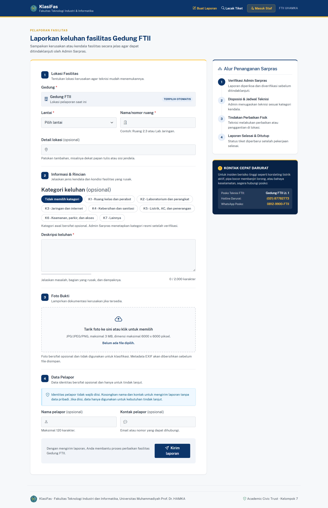

#### Halaman login staf

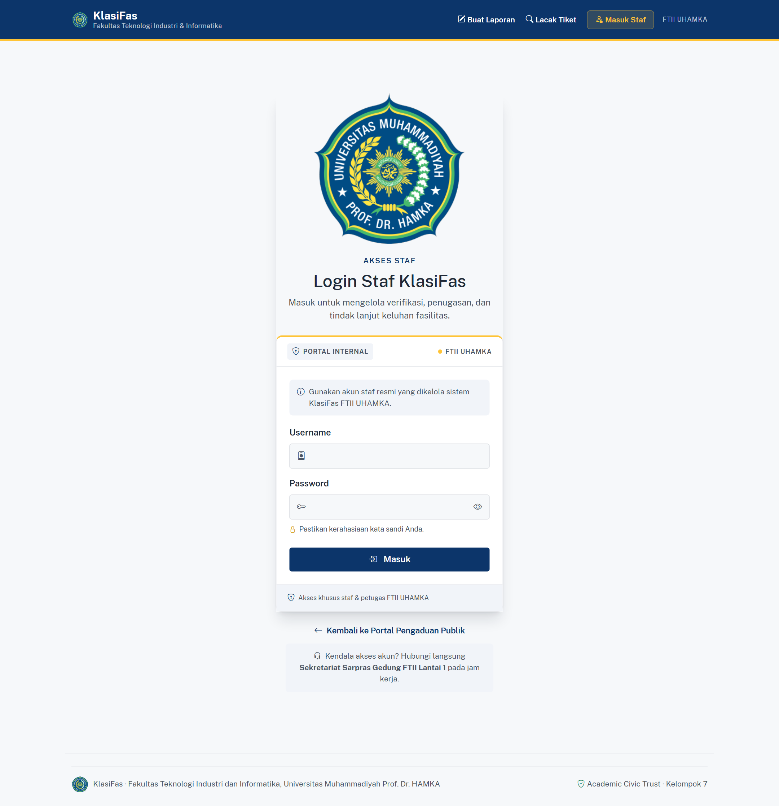

#### Antrean Admin Sarpras

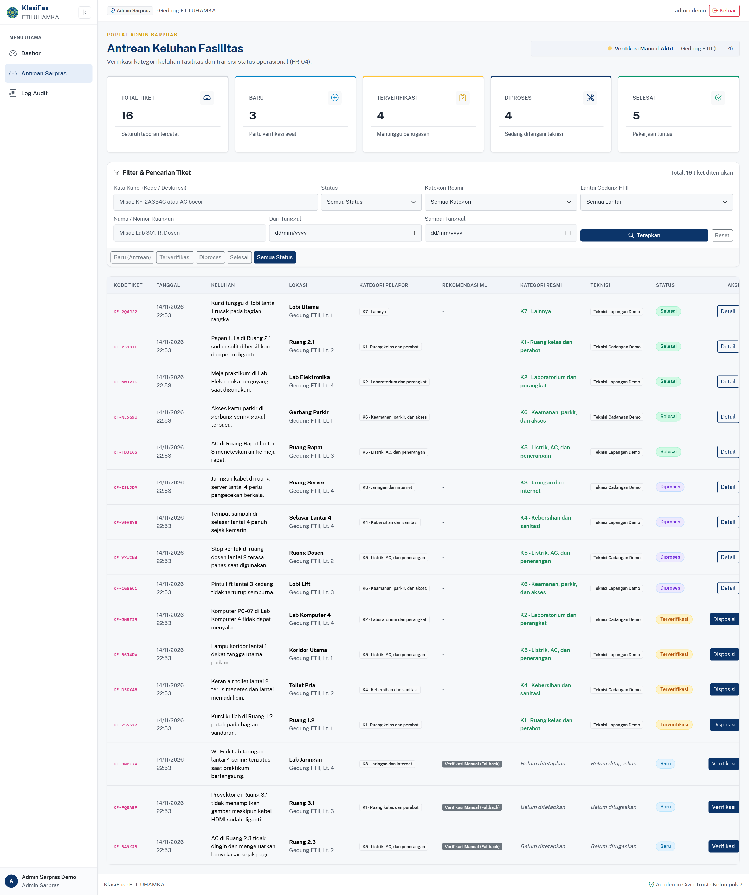

#### Sidebar dalam keadaan collapsed

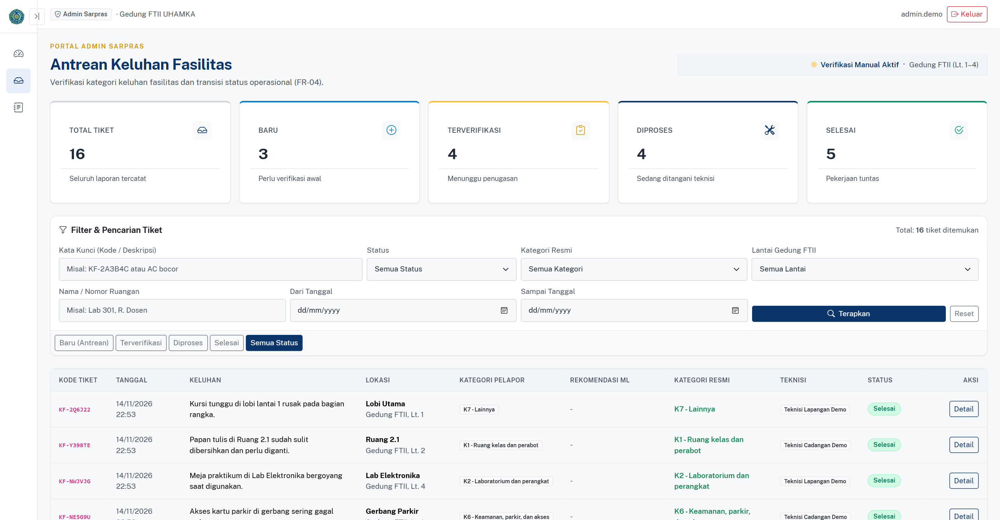

#### Verifikasi tiket oleh Admin Sarpras

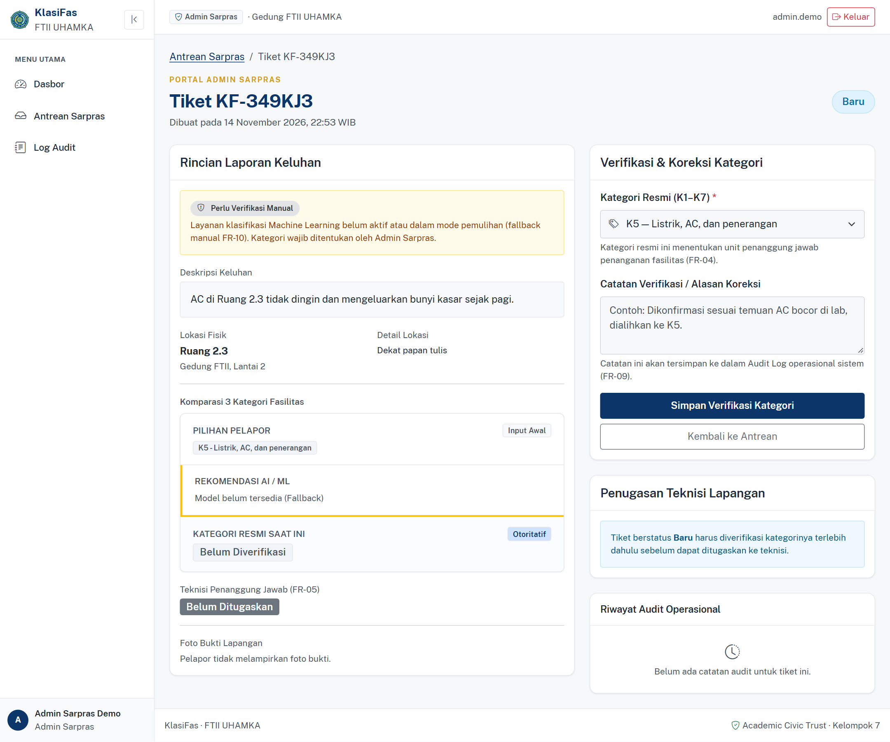

#### Form penugasan teknisi

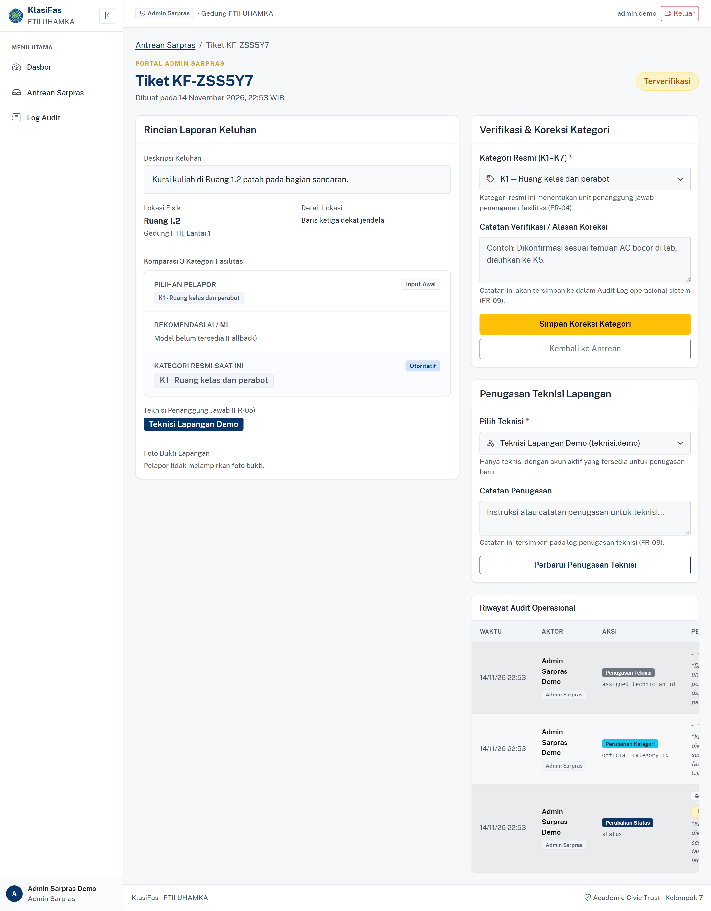

#### Papan tugas teknisi

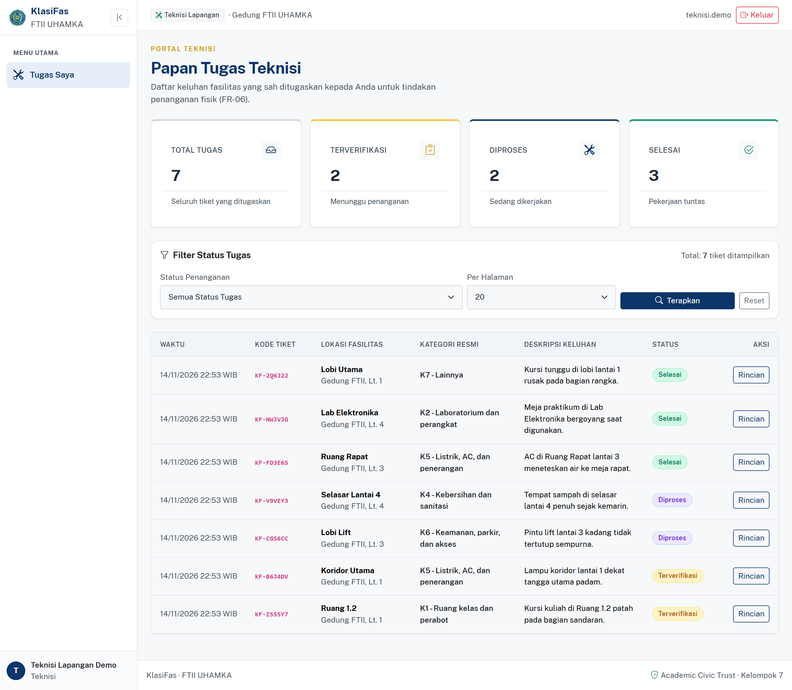

#### Detail tiket pada akun teknisi

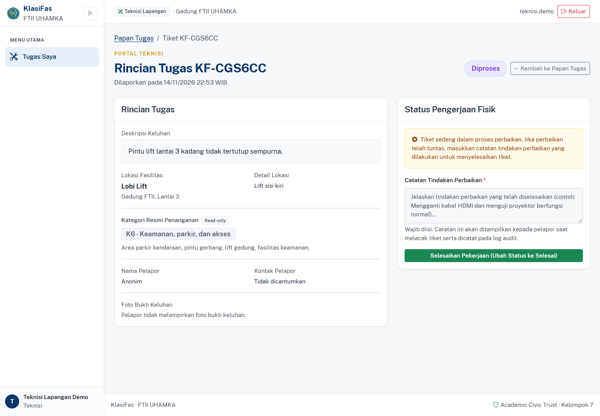

#### Audit log

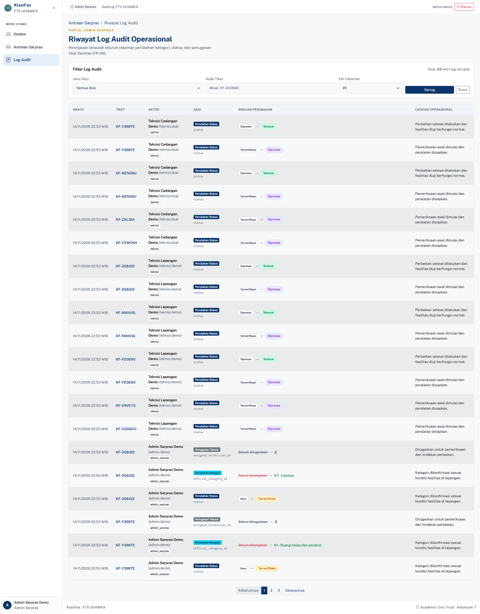

#### Dashboard manajerial

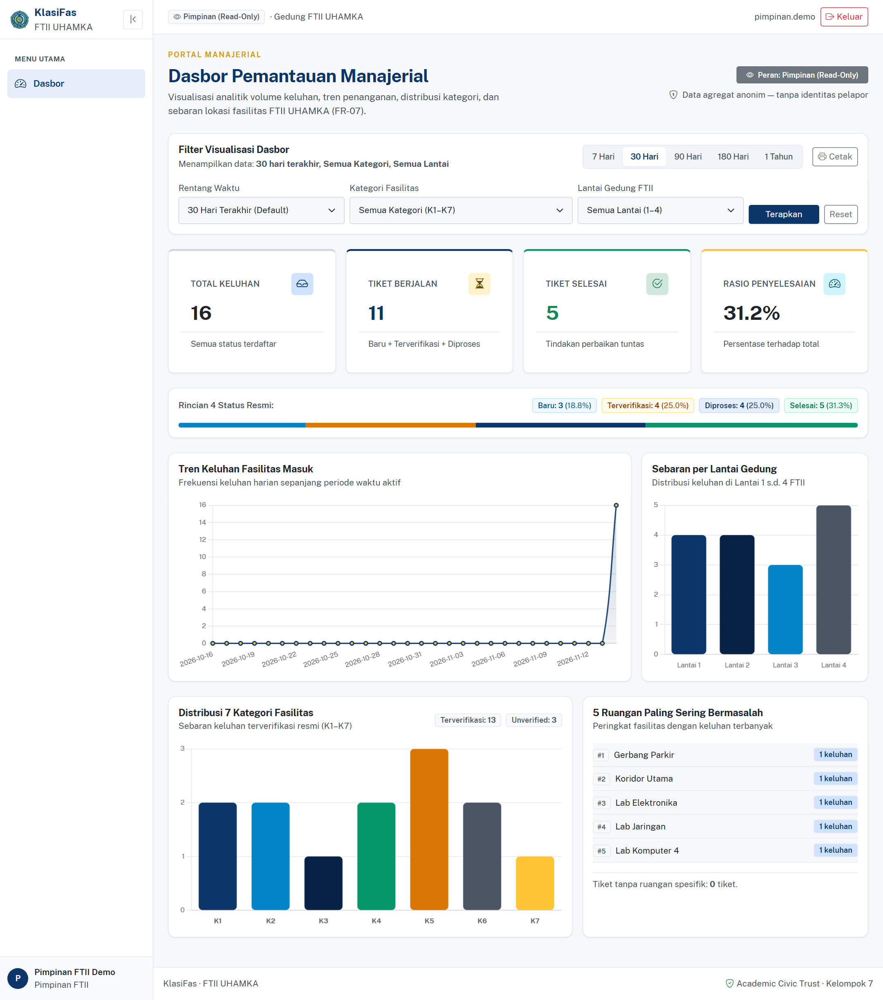

#### Hasil pelacakan publik

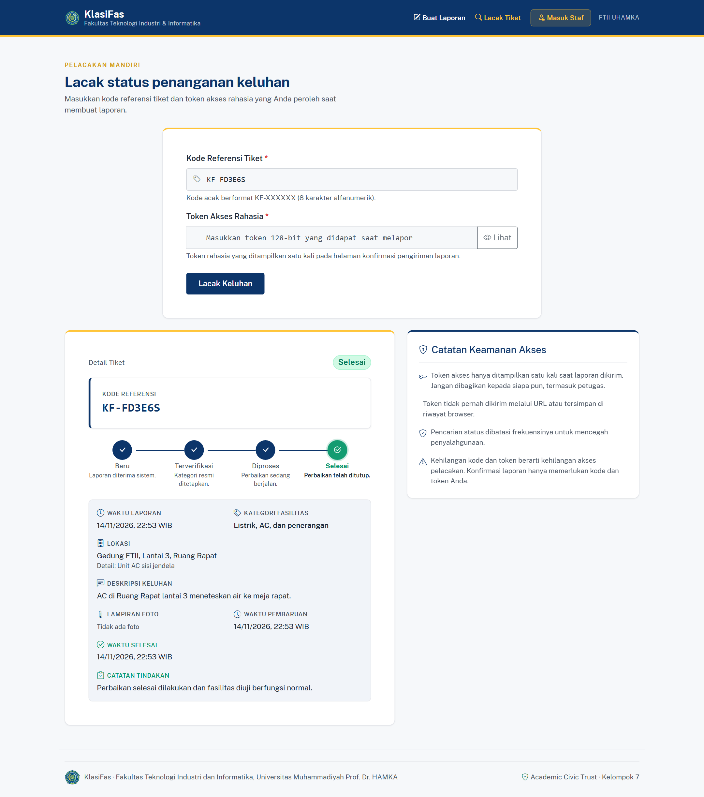

#### Navigasi mobile dengan drawer terbuka

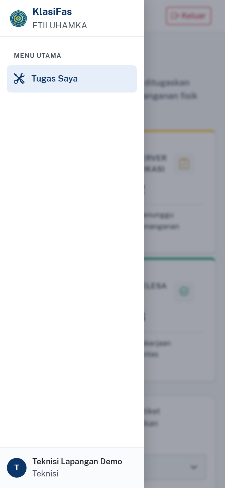

## 5. Skenario Fallback Manual

Fallback manual adalah jalur wajib FR-10, bukan kegagalan demonstrasi.

1. Jalankan demonstrasi tanpa artefak model, atau gunakan kondisi workspace saat ini jika `app/ml/models` belum berisi `model.joblib` dan `vectorizer.joblib`.
2. Kirim laporan melalui `/lapor` seperti biasa.
3. Periksa hasil di Admin Sarpras: tiket tetap tersimpan dengan status `Baru`; rekomendasi kategori dan confidence dapat kosong; penanda verifikasi manual aktif.
4. Admin memilih kategori resmi secara manual pada `/admin/tiket/<id>/verifikasi`.
5. Lanjutkan penugasan dan pengerjaan seperti alur normal.

Yang tidak boleh dilakukan:

- Jangan membuat dataset atau model palsu untuk memaksa hasil klasifikasi.
- Jangan menghapus, mengganti, atau memalsukan artefak model hanya untuk demo.
- Jangan mengubah kode, database, migration, atau kontrol keamanan.
- Jangan mengisi database dengan data tiket karangan melalui SQL; gunakan laporan yang dibuat melalui formulir.

## 6. Checklist Hasil Demonstrasi

- [ ] Laporan berhasil dibuat dan kode serta token ditampilkan satu kali.
- [ ] Pelacakan dengan kode dan token valid menampilkan status yang benar.
- [ ] Token salah atau kode tidak ditemukan menghasilkan respons generik.
- [ ] Admin dapat memverifikasi kategori dan status menjadi `Terverifikasi`.
- [ ] Admin dapat menugaskan teknisi aktif.
- [ ] Teknisi hanya melihat tiket yang ditugaskan kepadanya.
- [ ] Teknisi dapat memindahkan status ke `Diproses` lalu `Selesai` dengan catatan wajib.
- [ ] Pelacakan akhir menampilkan status `Selesai` dan catatan perbaikan.
- [ ] Audit log mencatat perubahan kategori, status, dan penugasan.
- [ ] Dashboard menampilkan agregat tanpa PII dan dapat difilter.
- [ ] Pimpinan hanya mendapat akses dashboard read-only.
- [ ] Fallback manual berhasil ketika model tidak tersedia.

## 7. Batas Demonstrasi

- Ini adalah MVP akademik lokal, bukan deployment produksi.
- Model ML belum tentu tersedia; jangan mengklaim hasil klasifikasi jika artefak belum ada.
- Masa berlaku token, penerbitan ulang token, retensi foto, dan pembersihan file masih TBD sesuai dokumen keamanan. Jangan menetapkannya dalam demo.
- Jangan menampilkan secret, password, token akses, hash token, atau data pribadi pelapor pada screenshot, log, atau rekaman demo.

## 8. Referensi Implementasi

- `app/routes/report.py`: `/lapor`, `/lacak`, respons sukses dan token sekali tampil.
- `app/routes/auth.py`: login/logout staf.
- `app/routes/admin.py`: antrean, verifikasi, penugasan, foto, audit log.
- `app/routes/technician.py`: papan tugas, detail, foto, perubahan status.
- `app/routes/dashboard.py`: dashboard dan API grafik.
- `app/services/ticket_report.py`: validasi laporan dan pembuatan tiket.
- `app/services/classification_service.py`: inferensi dan fallback manual FR-10.
- `app/services/complaint_service.py`: transisi status, verifikasi kategori, penugasan.
- `app/services/ticket_tracking.py`: sanitasi data pelacakan publik.
- `docs/SECURITY.md`: matriks akses, token, foto, dan batas keamanan.
- `README.md`: perintah setup, migrasi, akun staf, dan menjalankan aplikasi.
